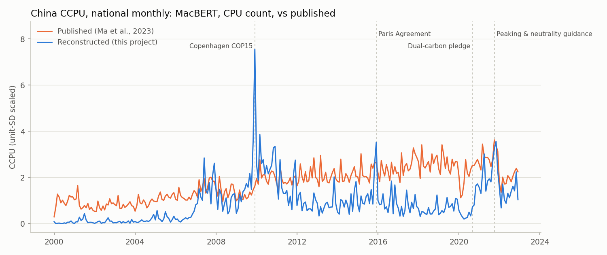
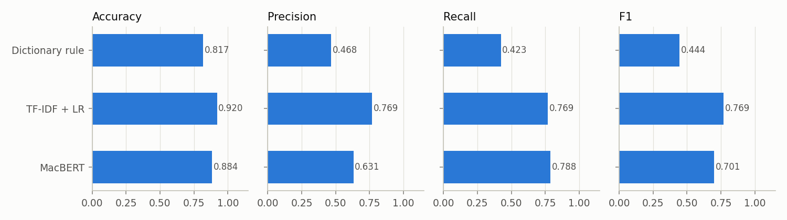

# China Climate Policy Uncertainty (CCPU) Index from Newspaper Text

An end-to-end, reproducible rebuild of the news-based **China Climate Policy Uncertainty** index of
[Ma et al. (2023, *Scientific Data*)](https://doi.org/10.1038/s41597-023-02817-5). The pipeline starts from 1.76 million raw
Chinese newspaper articles and ends with a daily, monthly and annual national index. It includes a fine-tuned
**MacBERT** classifier and the two inputs the original release does not contain: an **annotated training set** and
**trained model weights**.

Author: **reviver** · 中文项目说明见 [项目说明.md](项目说明.md).



## Highlights

| | |
|---|---|
| Corpus | 1,755,826 articles, 6 national newspapers, 2000–2022 (WiseNews export, [Figshare 24071310](https://doi.org/10.6084/m9.figshare.24071310.v3)) |
| Candidates | 115,192 articles (6.6%) with at least one climate term; filter recall checked on 300 random non-candidates (0 positives) |
| Labels | 2,300 articles from a stratified (year × newspaper) design, written guideline, LLM-assisted annotation, double coding of 300 items (inter-model κ = 0.92); blind human review of 100 items (κ = 0.40, see [About the labels](#about-the-labels)) |
| Classifier | `hfl/chinese-macbert-base` + linear head on [CLS], fine-tuned on CPU |
| Test F1 (301 held-out candidates) | MacBERT 0.701 · TF-IDF + LR 0.769 · dictionary rule 0.444 |
| Index | Baker-Bloom-Davis aggregation (paper p. 5), daily / monthly / annual |
| Validation | Correlation with the published series, landmark-event ranking, four alternative indices |

## Pipeline

```
raw CSV ─▶ parse & clean ─▶ climate-term filter ─▶ stratified sample ─▶ annotation (+κ, adjudication)
        text.py          lexicon.py, corpus.py    annotate.py          docs/ANNOTATION_GUIDE.md
   ─▶ MacBERT fine-tuning ─▶ predict 115k candidates ─▶ X_it = N_cpu/N_all, Y_it = X_it/σ_i, Z_t = mean_i Y_it ─▶ validation
      model.py, baselines.py   model.py (resumable)        index.py                                          report.py
```

## Quick start

```powershell
python -m venv .venv
.\.venv\Scripts\python.exe -m pip install -r requirements.txt -r requirements-model.txt
.\.venv\Scripts\python.exe run.py --help
```

Point `source_dir` in `config.json` to the folder holding the Figshare files. Then run the steps in
[`scripts/run_all.ps1`](scripts/run_all.ps1):

```powershell
python run.py build-corpus                 # 1 pass over the 7.7 GB CSV → article index + candidates
python run.py sample-labels                # stratified annotation sample → data/labels/batches/
python run.py merge-labels                 # κ, adjudication → data/labels/cpu_labels.csv
python run.py split-labels                 # 70/15/15, stratified
python run.py train-baselines              # dictionary rule, TF-IDF + logistic regression
python run.py train                        # MacBERT fine-tuning
python run.py predict                      # all candidates; resumable
python run.py build-index --predictions data/interim/predictions_macbert.csv --name ccpu_macbert
python run.py build-index --predictions data/interim/predictions_macbert.csv --measure count --name ccpu_macbert_count
python run.py report                       # tables + figures in outputs/
```

The fine-tuned weights (~390 MB) are too large for git. They are attached to the
[v1.0 release](https://github.com/liuzhenhao-513/China-Climate-Policy-Uncertainty/releases/tag/v1.0)
together with the config/tokenizer files and the TF-IDF model. Unzip `macbert-ccpu.zip` into `models/` to skip training.

## Results

### Classifier (held-out test set, 301 candidates)



| Model | Accuracy | Precision | Recall | F1 |
|---|---|---|---|---|
| Dictionary rule (climate ∧ policy ∧ uncertainty) | 0.817 | 0.468 | 0.423 | 0.444 |
| TF-IDF char 1–3-grams + logistic regression | 0.920 | 0.769 | 0.769 | 0.769 |
| MacBERT (top 6 layers fine-tuned, threshold 0.56) | 0.884 | 0.631 | 0.788 | 0.701 |

Both learned models clearly beat the dictionary rule, as in Table 3 of the paper. On this CPU budget (1,399 training
articles, half the encoder fine-tuned, 6 epochs), MacBERT does not outperform TF-IDF. With 52 test positives, the F1
standard error is about ±0.05. Training logs, including a failed first attempt (all-negative collapse without class
weights) and a rejected int8-quantization speed-up (75% agreement with fp32), are in `outputs/logs/` and
`outputs/validation/quantization_check.json`.

### Index vs the published series (2000–2022)

| Index | Monthly Pearson r | Monthly Spearman ρ | Annual Pearson r |
|---|---|---|---|
| **MacBERT, CPU count** (fixed denominator) | **0.48** | **0.63** | **0.52** |
| MacBERT, CPU share (paper formula) | 0.18 | 0.37 | 0.12 |
| TF-IDF + LR, count | 0.42 | 0.59 | 0.45 |
| Dictionary rule, count | 0.65 | 0.69 | 0.68 |
| Any climate term, share | 0.22 | 0.49 | 0.16 |

All values come from `outputs/validation/index_comparison.csv` (276 months, 23 years). MacBERT classifies 24,355 of the
115,192 candidates as CPU articles. The share version follows the paper's formula exactly, but it is dominated by the
deposit's changing composition (below). The broad dictionary count tracks the published series best, which matches
the finding that the published index moves with article volume.

### Landmark events

Rank of each landmark month among the 276 months of 2000–2022 (1 = highest; `outputs/validation/event_check.json`):

| Month | Event | MacBERT count | MacBERT share | Published |
|---|---|---:|---:|---:|
| 2007-06 | National Climate Change Programme | 10 | 2 | 119 |
| 2009-11 | China announces 2020 carbon-intensity target | 3 | 4 | 170 |
| 2009-12 | Copenhagen COP15 | **1** | **1** | 162 |
| 2011-12 | Durban COP17 | 13 | 54 | 94 |
| 2015-12 | Paris Agreement | 5 | 39 | 38 |
| 2017-12 | National ETS launched | 130 | 126 | 17 |
| 2020-09 | Dual-carbon pledge | 132 | 142 | 47 |
| 2021-07 | National ETS trading starts | 31 | 55 | 28 |
| 2021-10 | Peaking & carbon-neutrality guidance | 8 | 17 | **1** |
| 2021-11 | Glasgow COP26 | 4 | 18 | 5 |
| | **Events in the top 10% of months (of 12)** | **7** | 5 | 4 |

The reconstructed index peaks at international negotiations and at China's own target announcements. Half of the published series' ten highest months fall in **March** (2015, 2017, 2018, 2019, 2021),
the month of the National People's Congress, when newspapers publish the most articles. Neither index reacts strongly to the September 2020 pledge.

### A corpus-composition problem in the public deposit

The deposit is not a constant fraction of each newspaper's output. People's Daily has ~9,000 articles a year in
2000–2009 and ~37,000 in 2010–2019. The climate-term share jumps from ~3% to 14–26% in 2007–2009 and 2021–2022. China
News Service sits at ~40% climate articles throughout. This pattern points to exports built with different search
queries. Under the paper's formula (CPU share, deposit articles as denominator), these jumps leak into the index. The
repository therefore reports a **share** version (the paper's formula) and a **count** version (a fixed per-newspaper
denominator, closer to dividing by full newspaper output). Article volume alone correlates 0.69 with the published
monthly index, more than any CPU measure, so the published series appears to depend strongly on denominators that
were not released. See [docs/METHOD.md](docs/METHOD.md).

## Repository layout

```
├── run.py                  command-line entry point (python run.py <command>)
├── config.json             paths, seed, model and index settings
├── src/ccpu/
│   ├── text.py             WiseNews export parser and cleaner
│   ├── lexicon.py          climate / policy / uncertainty lexicons, focus window
│   ├── corpus.py           streaming corpus pass
│   ├── annotate.py         sample design, Cohen's κ, label merge, blind review sheet
│   ├── labels.py           validation and stratified split
│   ├── model.py            MacBERT classifier: train / evaluate / predict
│   ├── baselines.py        dictionary rule, TF-IDF + logistic regression
│   ├── index.py            CCPU aggregation and series comparison
│   ├── report.py           validation tables and figures
│   └── published.py        tidy export of the authors' Excel series
├── data/
│   ├── labels/             cpu_labels.csv, label_report.json, adjudication.csv, human_review_sample.csv
│   ├── reconstructed/      reconstructed indices (daily, monthly, annual; components by newspaper)
│   └── published/          the authors' published indices in tidy CSV form
├── docs/                   METHOD.md, ANNOTATION_GUIDE.md, DATA_DICTIONARY.md
├── 项目说明.md              project summary (Chinese)
├── scripts/                run_all.ps1 (full pipeline), check_quantization.py
├── outputs/                validation tables, figures, training/prediction logs, corpus audit
└── tests/                  unit tests (python -m unittest discover -s tests)
```

## About the labels

The original 28,800 human labels were not released. The labels here follow a guideline written for this project
([docs/ANNOTATION_GUIDE.md](docs/ANNOTATION_GUIDE.md)) that operationalises the paper's definition of CCPU.

* **Annotation (LLM-assisted).** Eight independent model instances read each article and returned a label, an
  uncertainty dimension, a confidence level and a reason.
* **Double coding.** 300 articles were coded by two different model instances, without being marked as duplicates
  (κ = 0.92), and the 7 disagreements were adjudicated. Agreement between model instances overstates human
  inter-rater reliability.
* **Human blind review (by the author).** I read a stratified random sample of 100 articles (50 labelled positive,
  50 negative) without seeing the labels and coded them by the guideline. My labels agreed with the training labels
  on 70% of them (Cohen's κ = 0.40). The sheet is `data/labels/human_review_sample.csv`; `python run.py
  review-agreement` recomputes the statistics.

In the blind review I marked 60 as CPU against 50 in the labels: 20 articles labelled 0 were judged positive and 10
labelled 1 were judged negative. The training labels therefore apply a narrower definition than a human reader, and the high inter-model κ
(0.92) overstates label reliability. Refining the guideline on these disagreements is the next step.

## Differences from the original implementation

* Single-CPU training: `max_length` 256 instead of 500, 4 epochs instead of 15. A *focus window* (title, lead, passages
  around climate terms) keeps the relevant text inside the shorter input.
* Fixes to the released scripts: a 1024/768 hidden-size mismatch in the base-model head, validation run in train
  mode, a device mismatch in inference, and hard-coded multi-GPU paths.
* Explicit handling of the 60 missing newspaper-months (the average over observed newspapers).
* Regional (provincial/city) indices are not rebuilt: the paper does not specify how articles are assigned to regions.

## Status and next steps

Every number in this README comes from an actual run: the corpus scan, the annotation, the training logs in
`outputs/logs/`, the 3.6-hour prediction over all 115,192 candidates, and the validation files in `outputs/validation/`.
Open items, in order of priority:

1. **Revise the label definition.** The 100-article blind review (κ = 0.40) shows that the LLM-assisted labels are
   narrower than a human reading. The next step is to revise `docs/ANNOTATION_GUIDE.md` on the 30 disagreements,
   relabel, and retrain.
2. **Full fine-tuning on a GPU** (`max_length` 500, `freeze_layers` 0, more epochs), with RoBERTa, LERT and PERT for
   comparison, as in Table 2 of the paper.
3. **Provincial indices**, assigning articles to provinces with a place-name gazetteer and comparing them with the
   published provincial series.
4. **Alternative denominators** for the share index, if per-newspaper article totals can be obtained from WiseNews.

## Citation

If you use the reconstructed indices, the annotated dataset or the code, please cite this repository (GitHub's
"Cite this repository" button uses `CITATION.cff`):

> reviver (2026). *China Climate Policy Uncertainty (CCPU): text-based index, annotated dataset and MacBERT
> classifier* (Version 1.0.0) [Computer software and dataset].
> https://github.com/liuzhenhao-513/China-Climate-Policy-Uncertainty

The methodology builds on, and the raw newspaper data and published comparison series come from:

> Ma, Y.-R., Liu, Z., Ma, D., Zhai, P., Guo, K., Zhang, D., & Ji, Q. (2023). A news-based climate policy uncertainty
> index for China. *Scientific Data*, 10, 881. https://doi.org/10.1038/s41597-023-02817-5

Code: MIT License. The published indices and the news deposit keep the terms of their Figshare records.
